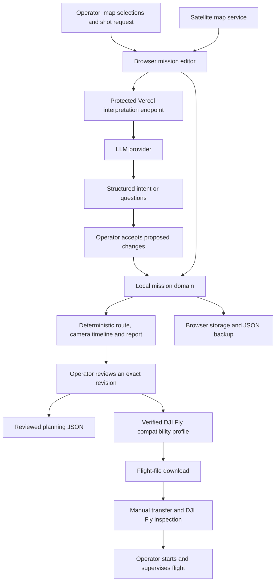

This project builds an LLM-powered controller for a DJI drone.

# System design

Status: proposed design with a TypeScript planner contract scaffold, 10 October 2026. The planner is a placeholder and does not calculate or validate plans. The separate KMZ round-trip experiment remains unchanged.

## Product and first scope

Build a web app hosted on Vercel that turns a filming or photography request into an editable mission plan for a DJI Mavic 4 Pro with a DJI RC Pro 2. A large language model (LLM) interprets the request. Geometry code calculates waypoints and camera angles. The operator reviews the result and supervises execution in DJI Fly.

The first version supports 2 mission types:

| Mission | Operator supplies | Planner produces |
| --- | --- | --- |
| Orbit | Selected target, radius, flight height, start bearing, direction and sweep | Ordered orbit waypoints with height, heading and gimbal pitch |
| Route through points | Ordered map points, flight height and framing choice | Ordered route waypoints with height, heading and gimbal pitch |

Support continuous video or a photograph at each selected stop. Start with a constant flight height for each mission. Changes in height, combined shots and automatic lens changes can follow once the basic workflow works.

DJI documents automatic waypoint routes, camera actions and saved missions for the Mavic 4 Pro. The manual also warns that the flown route curves between waypoints and can dip below waypoint heights. Our preview must show its planned geometry and state that the aircraft's actual interpolation remains to be checked. [DJI Mavic 4 Pro user manual, section 4.5](https://dl.djicdn.com/downloads/mavic-4-pro/20250925/DJI_Mavic_4_Pro_User_Manual_v1.2_en.pdf)

Live drone control, telemetry, camera feeds, automatic takeoff, obstacle detection and cloud synchronisation are outside the first scope. The app's execution workflow depends on DJI Fly.

## User workflow

1. Open the planner and select orbit or route.
2. Mark the planned takeoff point, target or route points on a satellite map.
3. Enter flight limits, height, speed and camera preferences.
4. Describe the shot, for example, "Film one clockwise circle around this target at 40m above takeoff, with a 30m radius."
5. Inspect the proposed changes and accept or edit them.
6. Review the map, waypoint list, camera timeline and unresolved checks.
7. Download a reviewed planning file. Download a DJI Fly flight file only when the compatibility milestone has passed.
8. Transfer the flight file manually, inspect it in DJI Fly and start the mission there under operator supervision.

The example's measurements describe a request. They are not recommended flight limits.

## Inputs

| Input | Required information | Source |
| --- | --- | --- |
| Shot objective | Natural-language description of the requested shot | Operator |
| Location | Planned takeoff coordinate and selected target or ordered route points | Operator's map selections |
| Orbit settings | Radius in metres, start bearing in degrees, clockwise or anticlockwise direction and sweep up to 360 degrees | Operator or explicitly accepted LLM suggestion |
| Flight settings | Constant height above planned takeoff in metres and speed in metres per second | Operator or explicitly accepted LLM suggestion |
| Planning limits | Minimum and maximum height, maximum distance from takeoff, speed, route length and estimated duration | Operator |
| Planning area | Allowed polygon covering the planned route; optional exclusion polygons | Operator's map drawing |
| Camera | Selected lens, photo or video mode, framing and photo dwell time if applicable | Operator |
| Target framing | Target height relative to planned takeoff, or explicit heading and gimbal pitch | Operator |
| Execution settings | Approach to the first waypoint, mission completion, return height and signal-loss behaviour | Operator; later matched to DJI Fly |
| Compatibility profile | Aircraft, controller and DJI Fly versions with verified file/action mappings | Integration milestone |

Drafts may contain missing values. The app asks for them before producing a complete reviewed plan. It never silently treats a missing height as zero or changes an operator limit to satisfy a shot.

Store named latitude and longitude fields in degrees using the World Geodetic System 1984 (WGS84). Store distances in metres, time in seconds and speed in metres per second. Heading runs clockwise from true north, from 0 inclusive to 360 exclusive. Gimbal pitch is 0 at the horizon and negative downwards.

Every height uses `heightAboveTakeoffM`. This is a vertical offset from the planned takeoff elevation. It is not height above the ground at each waypoint. A different actual takeoff location or elevation requires a new plan and review. Version 1 has no terrain conversion or terrain following.

### How we supply map and camera information

Use Mapbox GL JS with a satellite style as the initial map choice. The browser displays imagery and overlays the selected points, boundaries, route and camera directions. The operator identifies the subject and supplies its height. Mapbox provides satellite map styles; imagery is background context, not a current survey of obstacles. [Mapbox style documentation](https://docs.mapbox.com/mapbox-gl-js/guides/styles/set-a-style/)

The LLM receives selected object IDs, their roles, shot parameters and allowed bounds. It does not need satellite pixels or coordinates to interpret "orbit target A clockwise". The local planner already has target A's location. Free text still goes to the model provider and may contain location information supplied by the operator.

Camera proposals use the selected lens, the route and a declared framing choice. Target-facing heading and pitch come from geometry and the operator's target height. A schematic preview can illustrate directions; it cannot predict the actual composition, focus, exposure or visible obstacles. Check those in DJI Fly. Reference-image uploads and visual scene analysis can follow later.

## Outputs

Use JavaScript Object Notation (JSON) for portable planning files. KMZ denotes the compressed mission archive required by the candidate DJI Fly integration.

| Output | Contents | First-release status |
| --- | --- | --- |
| Editable preview | Route, numbered waypoints, camera directions, target, boundaries and a height diagram | Required |
| Waypoint and action list | Exact coordinates, height reference, speed, heading, pitch and ordered camera actions | Required |
| Validation report | Blocking errors, warnings, unknowns and operator checks | Required |
| Planning JSON | Versioned inputs, derived plan, units, report and review metadata | Required; not executable in DJI Fly |
| Draft backup JSON | Incomplete or blocked draft with its status preserved | Required; available before review |
| DJI Fly KMZ | Mission archive compiled from a reviewed plan using a verified compatibility profile | Gated integration |

Show nominal route length and duration, including known dwell time. The duration estimate excludes unverified approach, return, acceleration and environmental delays. It does not establish battery sufficiency.

A report that passes geometry checks means the plan meets the supplied mathematical constraints. The operator still checks the site, clearance, weather, battery, flight permissions and DJI Fly settings.

## Architecture

The planner contract is defined in [`src/index.ts`](src/index.ts). It outputs only waypoint values; the wider mission module owns actions, settings, review and export later.

Keep mission state and planning in the browser. Use a small Vercel function for language interpretation.



### Proposed stack and ownership

| Component | Choice | Responsibility |
| --- | --- | --- |
| Web app | Next.js, React and TypeScript on Vercel | Forms, map, preview, review and downloads |
| Map | Mapbox GL JS | Satellite background and visual overlays |
| Mission domain | Local TypeScript module | Input validation, geometry, actions, revisions, review and export eligibility |
| Local persistence | IndexedDB | Saved mission branches; JSON provides portable backups |
| Interpretation | Next.js route handler using the Node.js runtime | Protected, bounded model request and schema validation |
| Model | One provider with structured output support, selected before implementation | Interpret intent and request clarification |
| Access | Vercel Authentication with All Deployments protection | Restrict the initial app and endpoint to the owner's project access |
| Usage counters | Small managed Redis store, proposed [Upstash](https://upstash.com/docs/redis/features/restapi) | Atomic daily request quota and concurrent-request limit |
| DJI exporter | Private module inside the mission domain | Profile-specific encoding after compatibility validation |

Mapbox needs an account and a public browser token with limited scopes and allowed URLs. URL restrictions reduce misuse but are a best-effort control. Keep model and Redis credentials on the server. Next.js exposes `NEXT_PUBLIC_` variables to the browser. [Mapbox token guidance](https://docs.mapbox.com/accounts/guides/tokens/), [Next.js data security](https://nextjs.org/docs/app/guides/data-security)

Vercel currently supports All Deployments authentication on all plans, including production URLs. Enable it explicitly, restrict project access and avoid public bypasses. Confirm unauthenticated requests to the paid endpoint fail before enabling the provider key. Public GitHub source does not require public access to the running planner. [Vercel deployment protection](https://vercel.com/docs/deployment-protection)

The endpoint, `POST /api/interpret`, accepts small structured requests, checks their origin and bounds, reserves quota atomically and returns a validated result. Set a 30-second provider deadline, at most 1 provider call per request, no automatic paid retries and configurable output-token limits. Start with proposed application quotas of 100 interpretation requests per day and 1 concurrent request. These are product settings, not platform limits. Fail closed if quota storage is unavailable. Expire concurrency reservations after a bounded lease so an interrupted function cannot lock out the owner indefinitely.

Vercel limits function request and response bodies to 4.5MB. Our proposed endpoint cap is 64KB, with a 4,000-character objective. Keep imagery out of this request. Do not use function memory or its filesystem as durable mission or quota storage. [Vercel function limits](https://vercel.com/docs/functions/limitations)

Log request IDs, timings, outcome codes and usage. Exclude raw objectives and coordinates from application logs. Mission data stays in the browser; map requests still reveal the viewed area to the map service. Model inference requires connectivity. Local editing and geometry can continue after the app loads, but offline satellite maps are not promised.

## Domain and interface sketch

This section sketches the wider application domain. `MissionWaypoint` wraps the planner's waypoint values with application metadata and settings. These declarations are not implemented code.

```text
Coordinate = { latitudeDeg, longitudeDeg }
Target = { id, coordinate, heightAboveTakeoffM }

Shot = Orbit(targetId, radiusM, startBearingDeg, direction, sweepDeg)
     | Route(orderedAnchorIds)
Framing = FaceTarget(targetId) | Fixed(headingDeg, gimbalPitchDeg)
Capture = Video | PhotosAtStops(selectedStopIds, dwellS)
Camera = { lensId, framing, capture }

Draft = { missionId, branchId, revision, plannedTakeoff, selectedGeometry,
          shot, flightHeightAboveTakeoffM, speedMps, limits, camera,
          planningArea, exclusions, executionSettings, objective }

Action = StartRecording | StopRecording | TakePhoto
Waypoint = { coordinate, heightAboveTakeoffM, headingDeg, gimbalPitchDeg }
MissionWaypoint = { id, waypoint: Waypoint, speedMps,
                    arrival: Stop | PassThrough, dwellS, orderedActions }
Plan = { schemaVersion, plannerVersion, inputRevision,
         waypoints: MissionWaypoint[], transitions, estimates, findings }
Finding = { id, code, severity: Error | Warning | Unknown,
            message, affectedIds, blocksFlightExport }

Proposal = { requestId, baseRevision, inputDigest, proposedChanges }
ReviewedPlan = immutable { payload, payloadDigest, reviewReceipt }
Result = Success(value) | NeedsInput(questions) | Invalid(findings)
       | Stale | Unsupported(reason) | Unavailable(reason)

mission.edit(command) -> Result<MissionView>
interpret(request) -> Promise<Result<Proposal>>
mission.acceptProposal(proposal) -> Result<MissionView>
mission.review(expectedRevision, acknowledgedFindingIds) -> Result<ReviewedPlan>
mission.download(expectedRevision, format, profileId?) -> Result<File>
mission.backupDraft() -> File
mission.restore(file) -> Result<MissionView>
```

The interpretation request includes the request ID, base revision, input digest, selected geometry IDs and types, objective and allowed parameters. The model can suggest values within those bounds or return clarification questions. It cannot add locations, emit waypoint coordinates, generate code or create mission archives. Validate its response on the server and validate accepted changes again in the mission domain.

The user interface renders a `MissionView` and sends commands. It cannot write derived waypoints or review flags independently. The domain hides geometry, persistence, action sequencing and export rules behind these operations. Start with 3 main areas: `app`, `mission` and the server interpretation handler. Storage and exporters remain private parts of `mission`.

## Planning and camera rules

Calculate positions using geodesic distances and bearings, not arithmetic on latitude and longitude degrees. An orbit becomes a polygonal approximation with a proposed maximum chord deviation of 1m and at most 200 generated waypoints. A route accepts at most 100 selected anchors. These are application limits; a verified DJI profile may impose tighter limits. If the sampling target exceeds the point limit, return an error instead of degrading it silently.

Check the whole nominal route against the allowed polygon, exclusions and distance limits, including declared approach and exit segments. Check finite numbers, coordinate ranges, positive radius and speed, valid object references, height bounds, action ordering, gimbal range and duration limits. Do not claim that these checks cover DJI Fly's interpolated trajectory.

The canonical video sequence starts recording at the first shot waypoint, records through the shot and stops at the last shot waypoint. A full orbit includes its closing segment before stopping. Photography stops, applies the planned orientation, waits the explicit dwell time and takes 1 photograph. Export requires verification of that order and the controller's stop and orientation semantics.

Keep one selected lens for the mission. Treat exposure, focus and other settings as manual setup until the compatibility profile proves support. Never silently omit an action or substitute an unsupported camera setting.

Approach and return need explicit treatment. Version 1 previews declared nominal transitions and lists controller-managed behaviour separately. Any missing execution setting or unverified mapping blocks flight-file export. The app does not imply that a straight line to the first waypoint or back to takeoff is the aircraft's actual path.

## Revisions, storage and failure behaviour

Every accepted edit creates a new revision and recomputes the plan. Review captures an immutable payload containing all flight-affecting inputs, the derived plan, findings, planner version and export profile when selected. Hash that payload with a defined canonical serialisation, excluding the receipt and hash fields themselves. The receipt records the revision, digest, review time and acknowledged findings.

Download checks the expected revision against the current reviewed revision and checks the selected profile against the reviewed profile digest. It then uses that snapshot, never the current form fields. An edit, import or profile change invalidates review. Imports always require a fresh review. Generate flight-file bytes deterministically and record their checksum separately. These local hashes detect inconsistency; they do not provide independent proof of operator review or flight safety.

Apply an LLM response only when its request ID, revision and input digest still match the current request. Acceptance rechecks the match. A delayed response cannot overwrite a later edit.

Save each browser tab as a separate mission branch. Reopening a saved plan creates an editing branch rather than overwriting another tab's work. Do not merge concurrent branches in version 1. If browser storage fails, display an unsaved state and offer JSON backup. Clearing browser storage can remove saved missions, so backups remain necessary.

| Condition | Result |
| --- | --- |
| Missing height, framing or execution setting | Ask for input; preserve the draft |
| Impossible geometry or violated operator limit | Show blocking findings; disable reviewed-plan export |
| Unsupported camera action or unknown file mapping | Block flight-file export; keep planning and draft backup available |
| Terrain, weather or obstacle information unavailable | Show unknowns and operator checks; never label the route safe |
| Model refusal, invalid response, timeout or quota exhaustion | Preserve the draft; manual editing remains available |
| Late response to an older revision | Reject it as stale |
| Local storage failure | Mark the draft unsaved; offer backup |
| Unverified DJI Fly version tuple | Offer planning JSON; disable DJI Fly KMZ |

Review requires resolution of blocking plan errors and acknowledgement of remaining findings. Flight-file export additionally requires a verified profile and resolution of all findings marked `blocksFlightExport`. Environmental checks remain operator statements rather than app measurements.

## DJI Fly integration milestone

DJI Fly's built-in waypoint capability does not establish a supported third-party import interface. MavicMapper documents an unofficial procedure that replaces the file for a saved placeholder mission. Its guide also notes aircraft model-code requirements. We have inspected a native RC Pro 2 mission, and the operator has confirmed its decoded settings. On 10 October 2026, the operator confirmed that a regenerated, unchanged mission loaded after manually overwriting the saved placeholder on DJI Fly 1.21.12, Mavic 4 Pro firmware V01.00.0800 and RC Pro 2 firmware V01.00.0700. This confirms loading for that file and version tuple; execution remains unverified. [MavicMapper manual transfer guide](https://www.mavicmapper.jk4u.net/guides/import-kmz-into-dji-fly/)

### Native mission evidence

Recorded on 10 October 2026. The operator supplied the archive and version information, then confirmed that the extracted settings match DJI Fly.

| Item | Observed or reported value |
| --- | --- |
| Source archive | `9E12FF3A-DD58-4105-BC88-B226026BF707.kmz` |
| Archive SHA-256 | `dc7d250ba867c509be1453f375736786a038675c7c4f7e4c13db2deb18a908c2` |
| DJI Fly | 1.21.12 |
| Mavic 4 Pro firmware | V01.00.0800 |
| RC Pro 2 firmware | V01.00.0700 |
| Contents | `wpmz/template.kml` and `wpmz/waylines.wpml` |
| Mission model identifiers | `droneEnumValue=68`, `droneSubEnumValue=0` |
| Waypoints | 4, indexed 0 to 3 |
| Height | 50m at every waypoint; `relativeToStartPoint` |
| Speed | 2.5m/s at every waypoint, globally and for transitions |
| Heading | `followWayline` at every waypoint |
| Gimbal | Pitch and roll 0 degrees |
| Camera capture commands | No photo, start-recording or stop-recording commands |
| Turns | Curved stop at first and last point; curved pass through middle points |
| Completion | `goHome` |
| Signal loss | `executeLostAction` with `goBack` |

Archive integrity, XML parsing, matching mission configuration in both files and sequential waypoint indices passed local checks. These checks and the operator's confirmation establish a reference fixture for decoding. The operator also confirmed loading a regenerated, unchanged mission by manually overwriting and reopening the placeholder on the version tuple above. This confirms loading only; it does not establish execution behaviour or acceptance of changed geometry or actions. Return-to-home height and lens settings are absent from this fixture. Photo/video actions and target-facing framing still need separate native examples.

### Generated-file loading evidence

On 10 October 2026, the operator confirmed that `compatibility/baseline-roundtrip.kmz`, SHA-256 `1d0266b45afa1a82af6289f03258c62e1e8b88c202f85a5a826f2026baa7f4a0`, loaded after manual overwrite and reopening of the saved placeholder mission. The file was regenerated with the unchanged mission on DJI Fly 1.21.12, Mavic 4 Pro firmware V01.00.0800 and RC Pro 2 firmware V01.00.0700. This is evidence of loading for that unchanged mission and version tuple only.

### Compatibility checks

Before enabling KMZ export:

1. **Completed.** Create and save a small mission in DJI Fly on the user's controller, then obtain its original mission archive.
2. **Completed.** Record aircraft firmware, controller firmware and DJI Fly version.
3. **Completed.** Inspect the archive's schema, model identifiers, altitude reference, interpolation, actions and execution settings.
4. **Pending profile.** Define a profile bound to that version tuple, source fixture checksum and supported field mappings.
5. **Unchanged-mission loading confirmed; comparisons pending.** Regenerate the unchanged mission and transfer it manually; compare reopened settings and route for new geometry and actions.
6. **Pending supervised behaviour.** Validate flight and camera behaviour separately under operator supervision before treating the integration as usable.

Opening a generated file successfully proves parsing acceptance. It does not prove execution fidelity. Firmware or app changes require revalidation. Enterprise waypoint-schema documentation alone is insufficient to establish a consumer DJI Fly encoding.

Manual overwrite and reopening of the saved placeholder are confirmed on the user's hardware for the unchanged mission and recorded version tuple. The website downloads a file and does not promise to upload a mission directly to the RC Pro 2.

## Design rationale

We compared browser-owned planning with a server-owned mission service using a database. Use the browser design for the first version and adopt exact-revision review and export receipts from the server design.

This gives immediate local editing and avoids storing flight locations in a cloud mission database. It also means no automatic cross-device continuation, server-backed mission recovery or independently attested review history. A persisted service becomes useful if those requirements arise. The quota store holds operational counters, not mission data.

Direct LLM-generated waypoint files would combine language interpretation, route geometry and undocumented file encoding in one output. Separate those responsibilities so each result can be checked and edited.

## Implementation sequence and acceptance

| Step | Deliverable | Completion criterion |
| --- | --- | --- |
| 1. Check the integration | Authentic RC Pro 2 mission fixture and version tuple | Establish whether manual transfer and round-trip inspection are possible; record compatibility as verified or blocked |
| 2. Build the local planner | Waypoint inputs, orbit and route positions, headings and gimbal pitch | Deterministic waypoint results and input diagnostics |
| 3. Add the editor | Map, forms, preview, local saving and review | Both mission workflows work; edits invalidate review; backups restore as drafts |
| 4. Add interpretation | Protected Vercel endpoint with structured proposals | Missing data produces questions; stale replies cannot mutate plans; quotas and unauthorised access checks pass |
| 5. Add flight-file export | Profile-specific adapter and manual handoff instructions | Reopened route/settings and supervised behaviour match the reviewed plan |
| 6. Deploy the planner | Vercel configuration, map token, provider credentials and access protection | Build, typecheck, tests and lint pass; protection covers preview and production URLs |

Implementation tests should cover orbit closure and sampling, ordered routes, target-facing angles, action timing, polygon crossings, invalid values, profile limits, review invalidation, stale replies, import/reload, parallel tabs and storage failure. Endpoint tests should cover authentication enforcement, payload bounds, quotas and provider failures. Export checks should compare the exact reviewed payload and generated bytes.

Local planning and JSON work can proceed while flight-file compatibility remains unresolved. Do not describe the product as an executable DJI mission generator until the integration milestone passes.

### Remaining decisions and evidence

| Item | Needed before |
| --- | --- |
| Generated mission with changed geometry or actions accepted through the manual transfer method on the recorded version tuple | DJI exporter integration |
| Exact supported action, heading, gimbal and execution-setting semantics | Usable flight-file export |
| Model provider, model, map account and usage budget | Inference and deployment |
| Operator's numeric flight limits and selected lens | Each complete mission |

Implementation reconciliation: no application code exists yet. This README is the proposed contract. Update it when an accepted implementation decision changes inputs, outputs or ownership.
